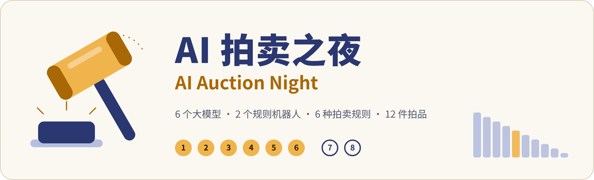
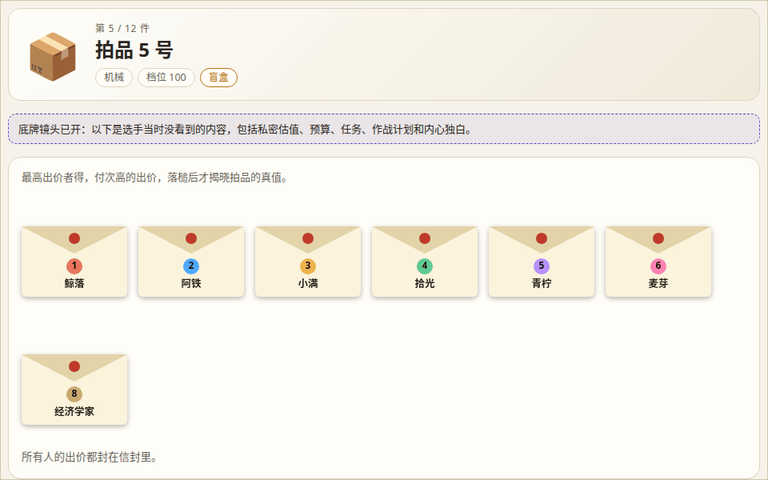
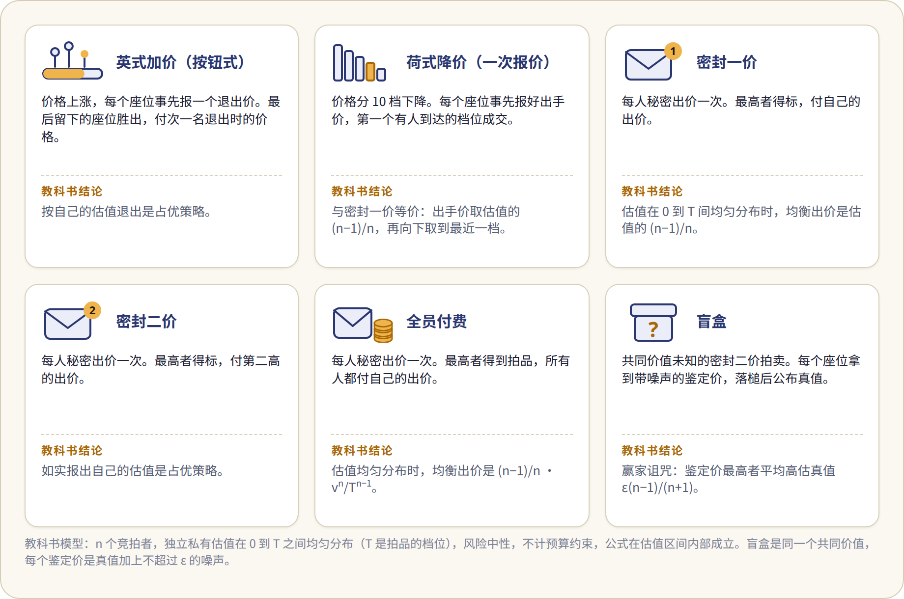

<p align="center"><a href="README.md">English</a> · <b>简体中文</b></p>

<p align="center"><picture>
<source media="(prefers-color-scheme: dark)" srcset="docs/assets/banner-zh-dark.png">
</picture></p>

<p align="center"><b>六个大模型和两个规则机器人，按六种教科书拍卖规则竞拍十二件拍品。拍完之后，由主持人和两位评委复盘这一夜。</b></p>

<p align="center">
<a href="https://github.com/YYYJH1/auction-night/actions/workflows/ci.yml"></a>

<a href="LICENSE"></a>
</p>

<p align="center"><picture>
<source media="(prefers-color-scheme: dark)" srcset="docs/assets/lot-dark.gif">
</picture><br>
<sub>夜号 <code>trial-d01-r1</code> 的第 5 件拍品，2026-11-02（UTC）由千问、DeepSeek、智谱的模型对拍：盲盒的赢家付 95 买下真值 84 的东西，正是赢家诅咒。</sub></p>

动图里那一夜可以在 <https://yyyjh1.github.io/auction-night/> 直接看。

## 这是什么

- 六个大模型和两个规则机器人一夜竞拍 12 件拍品。
- 每件拍品按六种教科书拍卖中的一种成交。
- 一夜里有发言、公开誓约、秘密任务，以及夜后主持人与两位评委的复盘。
- 每一夜都存成可以不联网、逐字节重放的录像，并发布成静态回放页。

<p align="center"><picture>
<source media="(prefers-color-scheme: dark)" srcset="docs/assets/formats-zh-dark.png">
</picture></p>

## 试一试

需要 Python 3.12 及以上，以及 [uv](https://docs.astral.sh/uv/)。模拟夜不需要网络，也不需要密钥。

```
uv sync
uv run auction-night run -c configs/night_mock.yaml -o runs/mock
uv run auction-night replay --from runs/mock
uv run auction-night export runs/mock
python3 -m http.server --bind 127.0.0.1 8000
```

服务器提供的是启动它的那个文件夹，所以要在仓库根目录启动。然后打开 <http://127.0.0.1:8000/viewer/index.html?replay=../runs/mock/replay.json>。

## 接真模型

真实模型的一夜走阿里云百炼（Bailian）的 API。动图里那一夜约花 \$1（¥6）。在自己的机器上，也可以用 vLLM 或 Ollama 提供的开源模型跑一夜，不花钱。命令和细节见 [docs/models_zh.md](docs/models_zh.md)。

## 了解更多

- [docs/how-it-works_zh.md](docs/how-it-works_zh.md)：一晚是什么样、一夜怎么过、夜后的复盘和架构
- [docs/models_zh.md](docs/models_zh.md)：真实模型、自己机器上的开源模型，以及一夜的成本
- [docs/commands_zh.md](docs/commands_zh.md)：全部命令、退出状态和检查
- [TRANSPARENCY_zh.md](TRANSPARENCY_zh.md)：一夜怎么跑、怎样查围标、种子怎样承诺、哪些内容会发布
- [docs/contracts_zh.md](docs/contracts_zh.md)：数据格式和六种规则的定义
- [CHANGELOG_zh.md](CHANGELOG_zh.md)：各版本的变化
- [CONTRIBUTING_zh.md](CONTRIBUTING_zh.md)：检查和文本扫描器

## 致谢

本项目在设计上受到以下项目启发：

- [AucArena](https://github.com/jiangjiechen/auction-arena)（jiangjiechen）：多模型拍卖竞技场、赛前计划
- [llm-auction](https://github.com/KeHang-Zhu/llm-auction)（KeHang-Zhu）：规则参数化与离线复算
- [Magentic Marketplace](https://github.com/microsoft/multi-agent-marketplace)（microsoft）：结构化动作与事件流
- [Monitored-Collusion-in-LLM-Auctions](https://github.com/EYITAY/Monitored-Collusion-in-LLM-Auctions)（EYITAY）：聊天与出价双检测
- [bid-pricing-collusion](https://github.com/linusc9516/bid-pricing-collusion)（linusc9516）：逐轮静态查看器
- [AI_Diplomacy](https://github.com/GoodStartLabs/AI_Diplomacy)（GoodStartLabs）：两层解说与高光时刻
- [llm-colosseum](https://github.com/OpenGenerativeAI/llm-colosseum)（OpenGenerativeAI）：节目化的模型对战与积分榜呈现
- [BidBrawl](https://github.com/merc-hecl/BidBrawl)（merc-hecl）、[qiju](https://github.com/TiantianFlow/qiju)（TiantianFlow）、[blind-auction](https://github.com/20010208/blind-auction)（20010208）：盲盒玩法、确定性状态机、种子承诺
- [collusion-harness](https://github.com/ArnolFokam/collusion-harness)（ArnolFokam）：缺失动作不得默认成价格
- [bazaar](https://github.com/lechmazur/bazaar)（lechmazur）：相对基准的超额收益

## 许可证

MIT，见 [LICENSE](LICENSE)。
