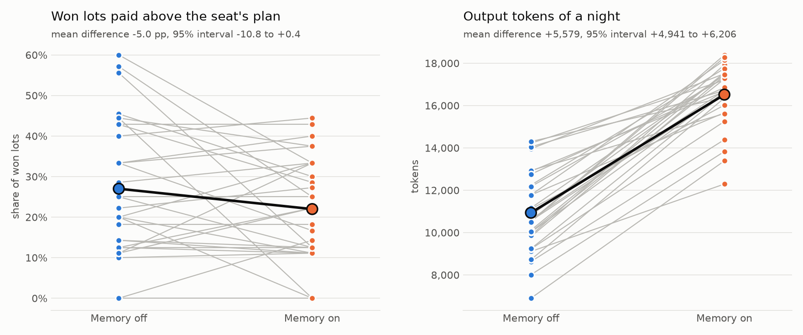

<p align="center"><b>English</b> · <a href="case-memory_zh.md">简体中文</a></p>

# Case study: showing a seat its own plan

## The question

Before the first lot every model seat writes an opening plan: a priority from 0 to 3 and an amount for each of the twelve lots. After that, the observation of a call holds the lot in progress, the seat's value or signal, its budget, what it has won, the results so far, the recent chat and its own recent thoughts. It does not hold the plan, and a pledge made before the chat window drops out of it. Season s1 has 15 highlights of a seat acting against its own plan, and some of them may come from a plan the seat could no longer see.

`night.memory: plan_pledges` adds one section to every observation after the plan. A real one, from a night of the experiment below:

```
【你的开场计划与仍然有效的誓约】
你的开场计划，第 6 件：重视程度 3（0 到 3），打算最多花 150。
计划里本件和之后各件打算最多花的合计：1050。
仍然有效的誓约（公开，涉及本件和之后的拍品）：
（暂无）
```

It tells the seat its plan for lot 6 (priority 3, at most 150), the sum of the amounts it planned for this lot and the ones after it, and the public pledges still in force, of which there are none here. The setting is off by default. With it off the observations, the configuration hash and the prompt hash are the bytes they were, so recorded nights replay unchanged.

## The experiment

- Every model seat is Qwen3-4B on a local vLLM server, and the two rule bots play as usual. The two configurations, [configs/night_local.yaml](../configs/night_local.yaml) and [configs/night_local_memory.yaml](../configs/night_local_memory.yaml), differ in this setting only.
- 30 decks, each played twice on one deal seed, once with the memory off and once with it on. The seed of deck k is the SHA-256 digest, in hex, of the text `auction-night-exp-memory-eval-k`.
- The measures are taken over the six model seats of a night: the share of won lots paid above the amount the winner had planned for the lot (the main measure), the share of lots of priority 2 or 3 that the seat did not bid on, the mean surplus of a model seat, the missions completed and the output tokens.
- For each deck the difference is memory on minus memory off. The table gives its mean over the 30 decks and a 95% interval from 10,000 bootstrap resamples of the decks.
- The measures were fixed before the evaluation nights were played. The main measure was at first the share of pledges kept. The model made pledges in one of six trial nights only, so the main measure became spending against the plan, before any number of the evaluation nights was seen. The evaluation nights then held no pledge at all.

## Results

<p align="center"></p>

| Measure | Memory off | Memory on | Difference [95% interval] |
|---|---|---|---|
| Won lots paid above the plan | 27.0% | 22.0% | −5.0 points [−10.8, +0.4] |
| Lots of priority 2 or 3 not bid on | 26.0% | 27.8% | +1.8 points [−1.3, +5.2] |
| Mean surplus of a model seat | −84.5 | −93.5 | −9.0 [−21.7, +4.8] |
| Missions completed in a night | 0.43 | 0.33 | −0.10 [−0.33, +0.13] |
| Output tokens of a night | 10,936 | 16,515 | +5,579 [+4,941, +6,206] |

All 60 nights finished, and one of 8,479 replies could not be parsed.

## What it shows

- With its plan in view, the model paid above its own plan less often, by about five points. The interval reaches zero, so 30 decks do not settle the effect.
- Surplus, bidding on the lots it ranked high and the missions did not move in a way these nights can tell apart.
- The model wrote about half again as many output tokens with the memory on, which is far more than the length of the section it read.
- With this model the plan is the weaker link. The prompt asks for twelve integers and does not say what they stand for. In all 360 plans of the evaluation the amounts add up to more than the seat's budget, 6.45 times the budget at the median, so they read as a cap for each lot and not as a split of the budget. The pledge half of the memory went untested, because the model made no pledge in the evaluation nights. All of this comes from one small model in every model seat, and says nothing yet about larger models or mixed tables.

## Reproduce

The summary of the 60 nights is [docs/data/exp-memory-eval.json](data/exp-memory-eval.json). The nights are played with a model served as described in configs/night_local.yaml, with its address in `LOCAL_LLM_BASE_URL`, deck by deck:

```
seed=$(printf %s auction-night-exp-memory-eval-1 | sha256sum | cut -c1-64)
AUCTION_NIGHT_SEED_LOCAL=$seed uv run auction-night run -c configs/night_local.yaml -o runs/exp-memory/eval/off/d01
AUCTION_NIGHT_SEED_LOCAL=$seed uv run auction-night run -c configs/night_local_memory.yaml -o runs/exp-memory/eval/memory/d01
```

The summary and the figure then come from the logs:

```
uv run python tools/exp_memory.py --phase eval --out summary.json
python3 tools/exp_memory_plot.py summary.json case-memory-en.png --lang en
```

The figure script needs matplotlib, which the project does not install.
