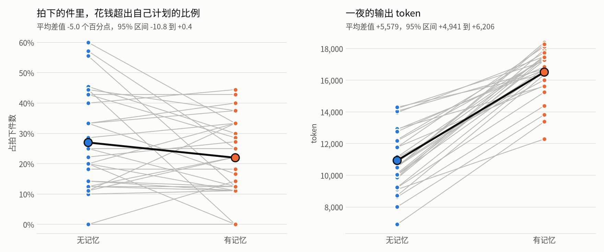

<p align="center"><a href="case-memory.md">English</a> · <b>简体中文</b></p>

# 技术案例：让座位看见自己的计划

## 问题

第一件拍品之前，每个模型座位都要交一份开场计划：给十二件拍品各定一个 0 到 3 的重视程度和一个金额。之后每次调用的观察里，有当前拍品、自己的估值或鉴定价、预算、已拍得的东西、已成交的结果、近期的聊天和自己最近的独白。观察里没有这份计划，聊天窗口之前立下的誓约也会掉出去。赛季 s1 有 15 条「座位违背自己计划」的高光，其中一些可能只是因为座位已经看不到自己的计划。

`night.memory: plan_pledges` 在计划之后的每次观察里加一节。下面是实验里一夜的原文：

```
【你的开场计划与仍然有效的誓约】
你的开场计划，第 6 件：重视程度 3（0 到 3），打算最多花 150。
计划里本件和之后各件打算最多花的合计：1050。
仍然有效的誓约（公开，涉及本件和之后的拍品）：
（暂无）
```

它告诉座位：自己对第 6 件的计划（重视程度 3，最多花 150），本件和之后各件计划金额的合计，以及仍然有效的公开誓约（这里没有）。这个设置默认关闭。关闭时，观察、配置哈希和提示词哈希都与原来逐字节相同，所以录下的夜照样能重放。

## 实验

- 每个模型座位都是本地 vLLM 上的 Qwen3-4B，两个规则机器人照常。两份配置 [configs/night_local.yaml](../configs/night_local.yaml) 和 [configs/night_local_memory.yaml](../configs/night_local_memory.yaml) 只差这一个设置。
- 30 副牌，每副用同一个发牌种子打两次，一次关闭记忆，一次打开。第 k 副牌的种子是文字 `auction-night-exp-memory-eval-k` 的 SHA-256 十六进制摘要。
- 指标按一夜的六个模型座位统计：拍下的件里，成交价超过赢家开场为该件计划金额的比例（主指标）；重视程度 2 或 3 的件里，座位没有出价的比例；模型座位的平均盈余；完成的任务数；输出 token。
- 每副牌算「打开减关闭」的差值。表里给出 30 副牌的平均差值，以及按牌重抽 10000 次的 bootstrap 95% 区间。
- 指标在评估夜开打之前就定好了。主指标原本是誓约的遵守比例。试跑的六夜里只有一夜有誓约，所以在看到任何评估数字之前，主指标改成了按计划花钱的情况。结果评估夜里一条誓约都没有。

## 结果

<p align="center"></p>

| 指标 | 关闭记忆 | 打开记忆 | 差值 [95% 区间] |
|---|---|---|---|
| 拍下的件里花钱超出计划 | 27.0% | 22.0% | −5.0 个百分点 [−10.8, +0.4] |
| 重视程度 2 或 3 的件没有出价 | 26.0% | 27.8% | +1.8 个百分点 [−1.3, +5.2] |
| 模型座位的平均盈余 | −84.5 | −93.5 | −9.0 [−21.7, +4.8] |
| 一夜完成的任务数 | 0.43 | 0.33 | −0.10 [−0.33, +0.13] |
| 一夜的输出 token | 10,936 | 16,515 | +5,579 [+4,941, +6,206] |

60 夜全部打完，8479 次回复里有 1 次没能解析。

## 说明了什么

- 看得见计划时，模型花钱超出自己计划的情况少了大约五个百分点。区间碰到了 0，所以 30 副牌还不能定论。
- 盈余、对自己看重的拍品出价的比例和任务完成，都没有出现这些夜能分辨的变化。
- 打开记忆后，模型的输出 token 多了大约一半，远远超过它多读的那一节的长度。
- 对这个模型来说，计划本身才是更弱的一环。提示词只要求交十二个整数，没有说它们代表什么。评估里的 360 份计划，金额合计全都超过了座位的预算，中位数是预算的 6.45 倍，所以这些金额更像每件的出价上限，而不是对预算的分配。记忆里关于誓约的一半没能检验，因为评估夜里模型一条誓约都没立。以上全部来自六个模型座位都用同一个小模型的情形，对更大的模型或混合阵容还说明不了什么。

## 复现

60 夜的汇总在 [docs/data/exp-memory-eval.json](data/exp-memory-eval.json)。按 configs/night_local.yaml 里的说明起一个模型服务，把地址写进 `LOCAL_LLM_BASE_URL`，再逐副牌打：

```
seed=$(printf %s auction-night-exp-memory-eval-1 | sha256sum | cut -c1-64)
AUCTION_NIGHT_SEED_LOCAL=$seed uv run auction-night run -c configs/night_local.yaml -o runs/exp-memory/eval/off/d01
AUCTION_NIGHT_SEED_LOCAL=$seed uv run auction-night run -c configs/night_local_memory.yaml -o runs/exp-memory/eval/memory/d01
```

汇总和图从日志生成：

```
uv run python tools/exp_memory.py --phase eval --out summary.json
python3 tools/exp_memory_plot.py summary.json case-memory-zh.png --lang zh
```

画图脚本需要 matplotlib，项目本身不安装它。
