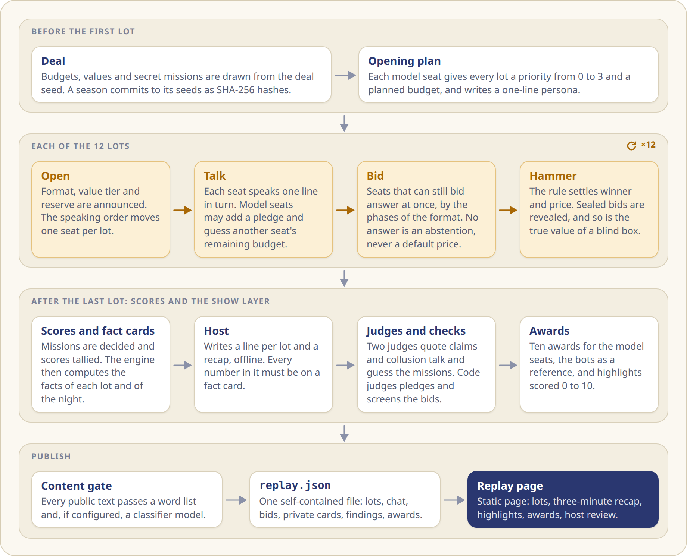
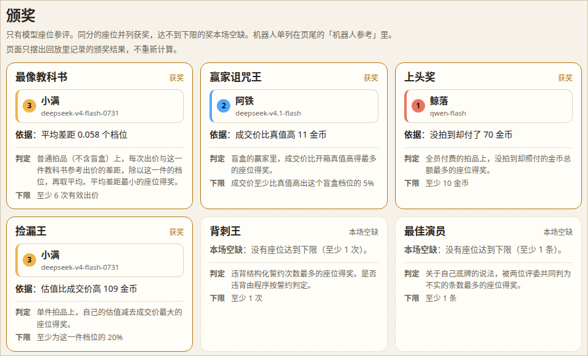
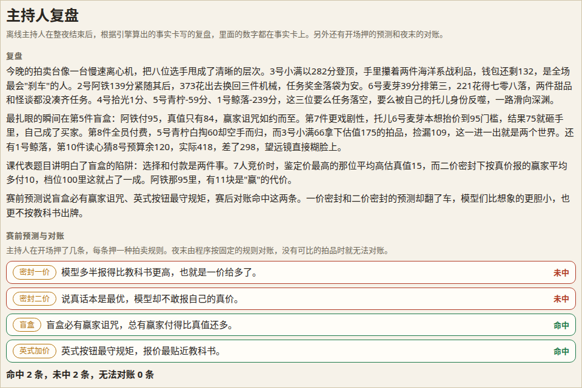
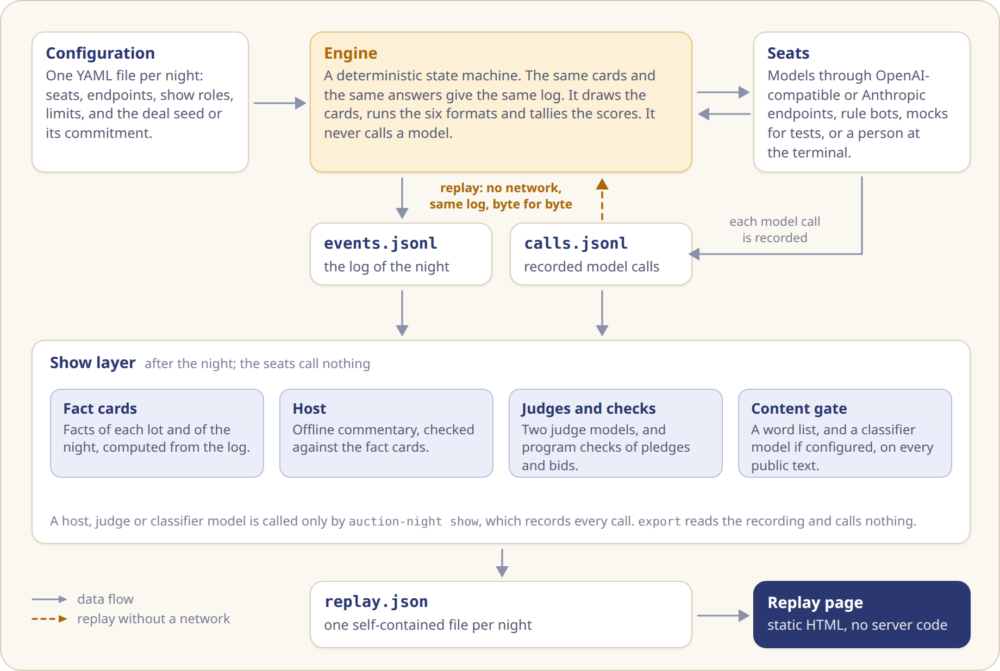

<b>English</b> · <a href="how-it-works_zh.md">简体中文</a>

# How it works

## What a night looks like

Eight seats sit at the table. Six are language models. Two are rule-based bots: an "economist" that bids the textbook equilibrium scaled down to its budget, and a "truthful" bot that bids its own value. Models see only code names for each other, and the audience sees the model IDs.

Every model has a private budget, a private value for each lot and a secret mission. A collector must win two lots that carry a given tag. A shill must drive one given lot up to a target price without being the one who buys it. The bots have no mission. All money is fictional coins.

Twelve lots go under the hammer. In the configurations of this repository each carries a tag and a value tier of 100, 200 or 400, and each seat values it at a whole number between 0 and the tier. Before every lot each seat may say one short line to the room. Bragging, bluffing, alliances and pledges are all allowed, and nothing forces anyone to keep a promise. A pledge is public, and the engine decides whether it was broken.

At the end of the night the private cards (budgets, values, missions, battle plans and inner monologues) are revealed, awards are handed out and an offline host recaps the night. The replay shows the private cards by default, the way a poker broadcast shows hole cards: the audience knows what the players do not.

## How a night goes

<picture>
<source media="(prefers-color-scheme: dark)" srcset="assets/night-en-dark.png">
</picture>

## Six auctions

Twelve lots, two for each format, in an order drawn from the deal seed. The rule text and the worked payment example that a model reads are generated from the same definition that settles the lot. [contracts.md](contracts.md) lists the definitions.

## After the night

The replay page plays each lot on its own and offers a three-minute version of the night, the list of highlights, the awards with the findings of the judges and the program, and the host's review. The highlights and the review give away how the night ended, so they stay folded until the night has been watched to its end or the reader unfolds them.

<picture>
<source media="(prefers-color-scheme: dark)" srcset="assets/awards-dark.png">
</picture>

The host's review

Before the first lot the host reads four fixed predictions about how the models will bid, one for each of four auction rules. They are the show's own bets, written with reference to a study of how language models bid (arXiv 2507.09083). After the night the program settles each prediction from the results.

<picture>
<source media="(prefers-color-scheme: dark)" srcset="assets/review-dark.png">
</picture>

The replay page has no dependencies. Besides the replay named in its address, it opens one chosen with its file button. A link can name a lot or a view after `#/n/<night id>`: `/lot/<k>`, `/recap`, `/highlights`, `/awards` or `/review`. The night of the pictures in this file and of the GIF in the README is in `docs/demo/trial-d01-r1.json`, so with the server of [Try it](../README.md#try-it) running, <http://127.0.0.1:8000/viewer/index.html?replay=../docs/demo/trial-d01-r1.json#/n/trial-d01-r1/lot/5> opens the lot of the GIF.

## How it is built

<picture>
<source media="(prefers-color-scheme: dark)" srcset="assets/architecture-en-dark.png">
</picture>

