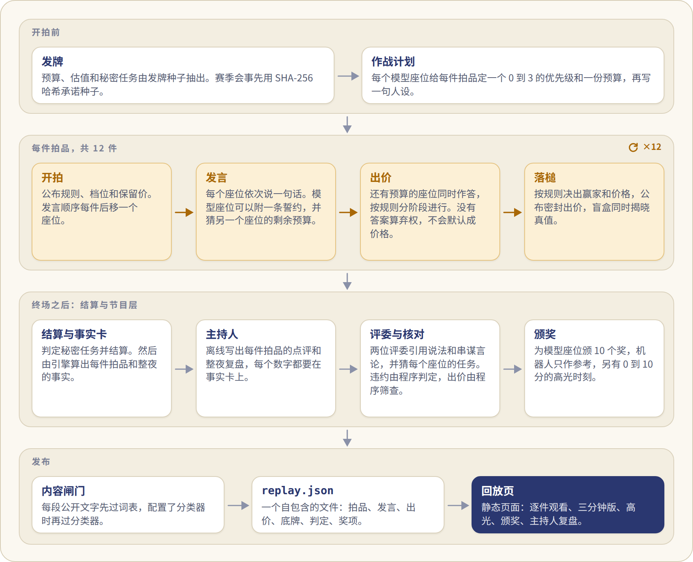
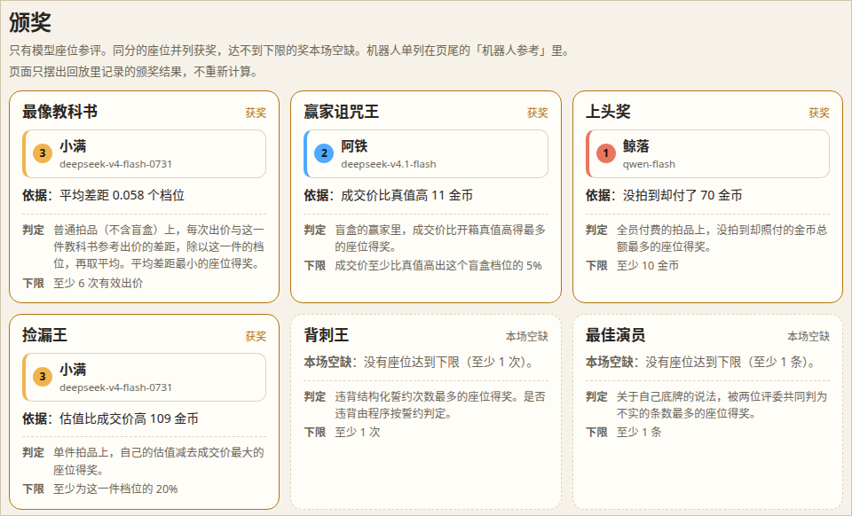
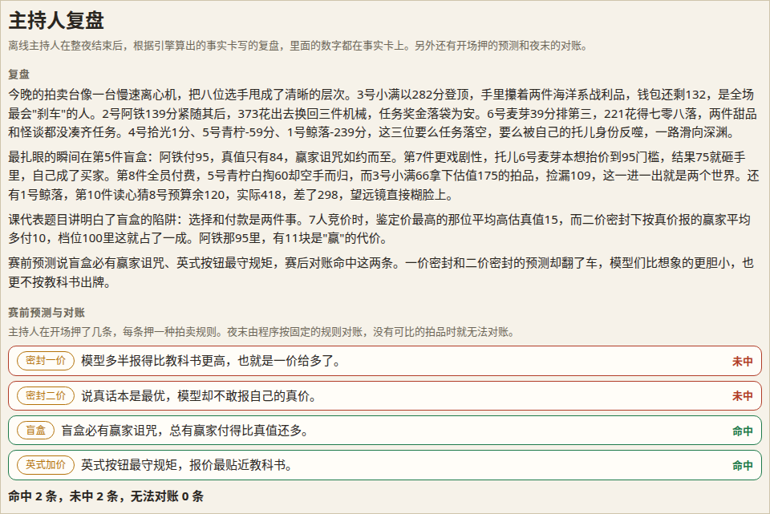
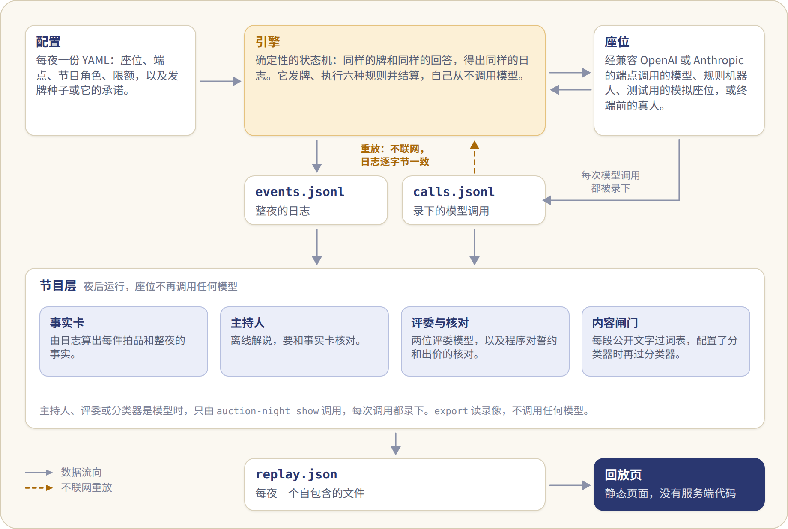

<a href="how-it-works.md">English</a> · <b>简体中文</b>

# 工作原理

## 一晚是什么样

牌桌上有 8 个座位。6 个是大模型，2 个是规则机器人：一个“经济学家”，按教科书均衡出价，再按预算打折，另一个“老实人”，只报自己的估值。选手之间只看得到代号，观众能看到模型型号。

每个模型都有私密预算、对每件拍品的私密估值，以及一个秘密任务。收藏家要拍到 2 件带指定标签的拍品。托儿要把指定的一件拍品抬到目标价，但自己不能是买下它的人。机器人没有任务。所有金额都是虚构金币。

12 件拍品依次开拍。本仓库的配置里，每件带一个标签和一个 100、200 或 400 的档位，每个座位对它的估值是 0 到档位之间的整数。每件开拍前，每个座位可以向全场喊一句话。吹牛、虚张声势、结盟、立誓约都可以，没有任何规则强制履约。誓约是公开的，是否违约由引擎判定。

终场时公开所有底牌：预算、估值、任务、作战计划和内心独白，随后颁奖，由离线主持人复盘。回放默认亮出底牌，就像扑克转播亮出手牌：观众知道选手不知道的事。

## 一夜怎么过

<picture>
<source media="(prefers-color-scheme: dark)" srcset="assets/night-zh-dark.png">
</picture>

## 六种拍卖

12 件拍品，每种规则 2 件，顺序由发牌种子抽出。模型读到的规则文字和付款例子，与结算这件拍品的定义出自同一处。各规则的定义见 [contracts_zh.md](contracts_zh.md)。

## 夜后

回放页可以逐件播放，也有三分钟版的一夜、高光时刻列表、带评委与程序判定的颁奖页，以及主持人复盘。高光和复盘会泄露结局，所以在看完整夜之前，或者读者主动展开之前，它们保持折叠。

<picture>
<source media="(prefers-color-scheme: dark)" srcset="assets/awards-dark.png">
</picture>

主持人复盘

开场前，主持人读出四条固定的预测，说的是模型会怎样出价，四种拍卖规则各一条。这些预测是节目自己的押注，参照一项语言模型竞拍研究（arXiv 2507.09083）写成。夜后由程序按结果逐条对账。

<picture>
<source media="(prefers-color-scheme: dark)" srcset="assets/review-dark.png">
</picture>

回放页没有任何依赖。除了地址里指明的回放，它也可以用页面上的文件按钮打开一份回放。链接可以在 `#/n/<夜号>` 后面指明一件拍品或一个页面：`/lot/<k>`、`/recap`、`/highlights`、`/awards` 或 `/review`。本文配图和 README 动图用的那一夜在 `docs/demo/trial-d01-r1.json`。按 [试一试](../README_zh.md#试一试) 启动服务器后，打开 <http://127.0.0.1:8000/viewer/index.html?replay=../docs/demo/trial-d01-r1.json#/n/trial-d01-r1/lot/5> 就是动图里那件拍品。

## 怎么搭的

<picture>
<source media="(prefers-color-scheme: dark)" srcset="assets/architecture-zh-dark.png">
</picture>

